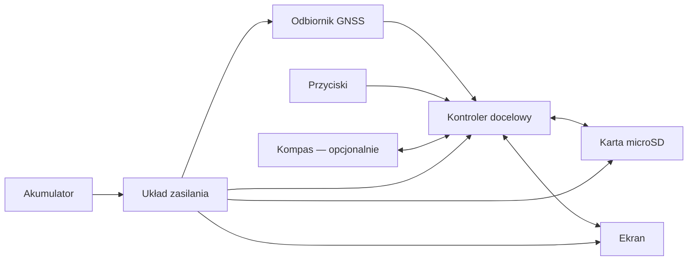

# Architektura systemu

**Status:** koncepcja; interfejsy i platforma docelowa nie zostały zatwierdzone.

## Główne bloki

Diagram przedstawia wyłącznie docelowe funkcje blokowe. Nie jest schematem elektrycznym ani instrukcją połączeń.

## Bloki funkcjonalne

| Blok | Rola | Status |
|---|---|---|
| GNSS | Pozycja, czas, prędkość i dane nawigacyjne | Moduł wstępnie opisany jako zgodny z NEO-7M; płytka i pinout do weryfikacji |
| Kontroler | Parsowanie danych GNSS, obsługa pamięci i interfejsu, renderowanie map | Nie wybrano platformy docelowej |
| Pamięć microSD | Lokalne mapy, punkty i zapis śladów | Czytnik niepotwierdzony w dostępnych komponentach |
| Ekran | Mapa i interfejs użytkownika | Dostępne LCD 16×2 i Grove LCD RGB; ekran mapowy do wyboru |
| Przyciski | Obsługa widoków i funkcji | Kilka przycisków THT dostępnych |
| Zasilanie | Konwersja napięć, zabezpieczenia i ładowanie | Architektura do zaprojektowania; brak potwierdzonego zestawu akumulatorowego |
| Kompas | Kierunek urządzenia | Funkcja opcjonalna, brak potwierdzonego modułu |

## Decyzje, które trzeba podjąć przed projektem PCB

1. Wymagany obszar i szczegółowość map oraz format danych.
2. Wymagana rozdzielczość i przekątna ekranu.
3. Wybór kontrolera na podstawie RAM, Flash, interfejsów, wydajności i zużycia energii.
4. Wybór czytnika microSD i interfejsu komunikacyjnego.
5. Schemat zasilania, źródło energii, ładowanie i zabezpieczenia.
6. Złącza, sposób programowania, debugowania i aktualizacji firmware.

Nie zamrażaj projektu PCB, dopóki te decyzje nie będą uzasadnione.
